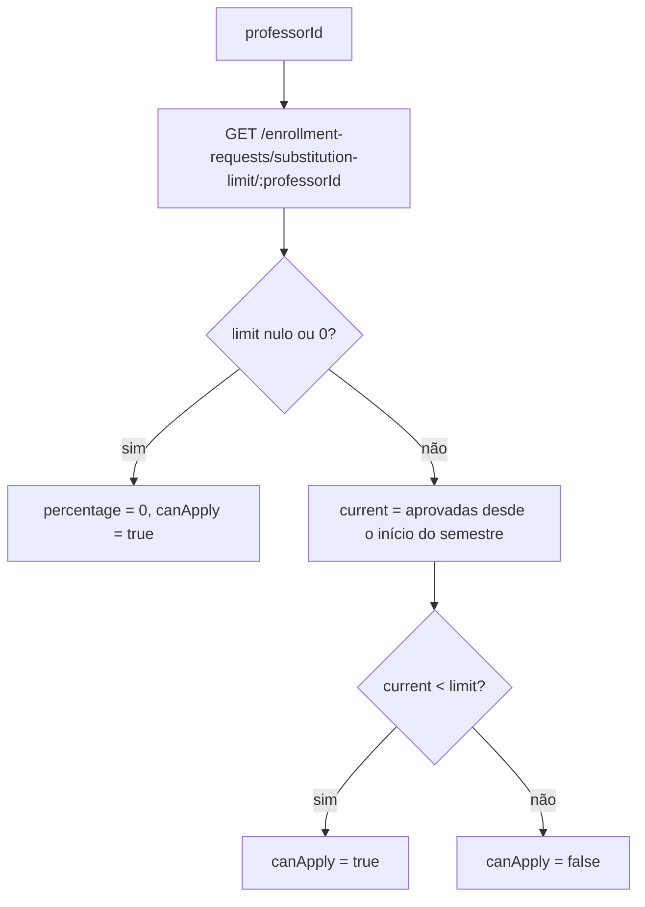

# Módulo: Limite de Substituições

O limite de substituições (teto por semestre) controla quantas aulas aprovadas um professor pode assumir em um semestre.

## Objetivo

- Limitar a quantidade de substituições por professor por semestre
- Bloquear novas candidaturas quando o limite é atingido
- Exibir o saldo/percentual ao professor

## Fonte de Dados

| Dado | Endpoint |
|------|----------|
| Limite, contagem do semestre, percentual e "pode candidatar-se" | `GET /enrollment-requests/substitution-limit/:professorId` → `{current, limit, percentage, canApply}` |

O cálculo é feito **no servidor** (correção P14): o semestre começa em 01/01 ou 01/07 pelo relógio do servidor, e a contagem considera só candidaturas `APPROVED` desde então. O front apenas exibe.

## Hook `useSubstitutionLimit` (`src/hooks/useSubstitutionLimit.ts`)

### Retorno

| Campo | Tipo | Descrição |
|-------|------|-----------|
| `current` | number | Nº de candidaturas aprovadas no semestre |
| `limit` | number \| null | Limite do professor (`null` = sem restrição) |
| `percentage` | number | `round(current / limit * 100)` (0 se `limit` nulo/zero) |
| `canApply` | boolean | `true` se `limit === null` ou `percentage < 100` |
| `loading` | boolean | Estado de carregamento |
| `error` | string \| null | Mensagem de erro |

## Cálculo (no servidor)

## Uso no Frontend

### Página `/classes`

- `useSubstitutionLimit(user?.id)` → `canApply`, `limit`, `current`, `percentage`
- Botão "Candidatar-se" fica desabilitado quando `!canApply`
- O texto do botão muda para **"Limite atingido"**
- Ao tentar candidatar com limite atingido, exibe toast de erro

### Dashboard legado

- `SubstitutionCounter` exibe o contador visual (apenas `profileId 3` no mapeamento legado)

## Componente `SubstitutionCounter` (`src/components/SubstitutionCounter.tsx`)

| Prop | Tipo | Descrição |
|------|------|-----------|
| `current` | number | Substituições atuais |
| `limit` | number \| null | Limite |
| `percentage` | number | Percentual |
| `loading` | boolean | Estado de carregamento |

### Cores por faixa

| Faixa | Cor | Significado |
|-------|-----|-------------|
| `< 80%` | Verde | OK |
| `>= 80%` | Amarelo | Aviso |
| `>= 100%` | Vermelho | Bloqueado |

## Regras de Negócio

1. `limit === null` → sem restrição (`canApply = true`)
2. `percentage >= 100` → bloqueado (`canApply = false`)
3. O backend também valida o limite ao processar a candidatura (validação de segurança)

## Pontos de Atenção

1. O cálculo do semestre é feito **no servidor** (P14) — não depende mais do relógio do navegador.
2. O backend é a fonte de verdade; o bloqueio no frontend é apenas UX.
3. `limit` vem do **professor** (`Users.substitutionLimitPerSemester`). Não existe tela nem rota da API para defini-lo — hoje só pelo banco (defeito D6 em `docs/status-funcionalidades.md`). A coluna homônima em `Schools` existe, mas não é usada no cálculo.